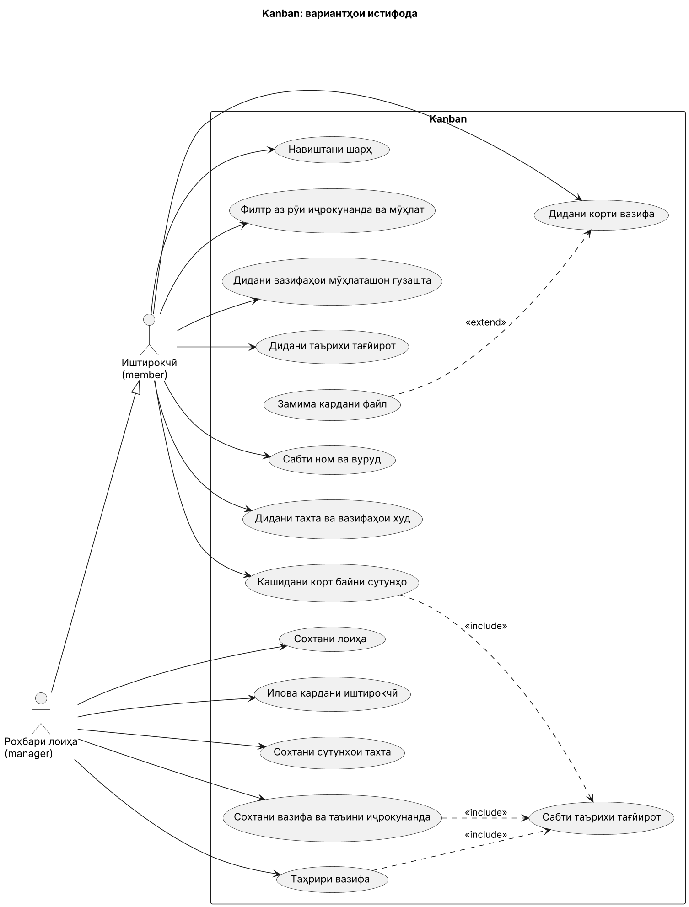
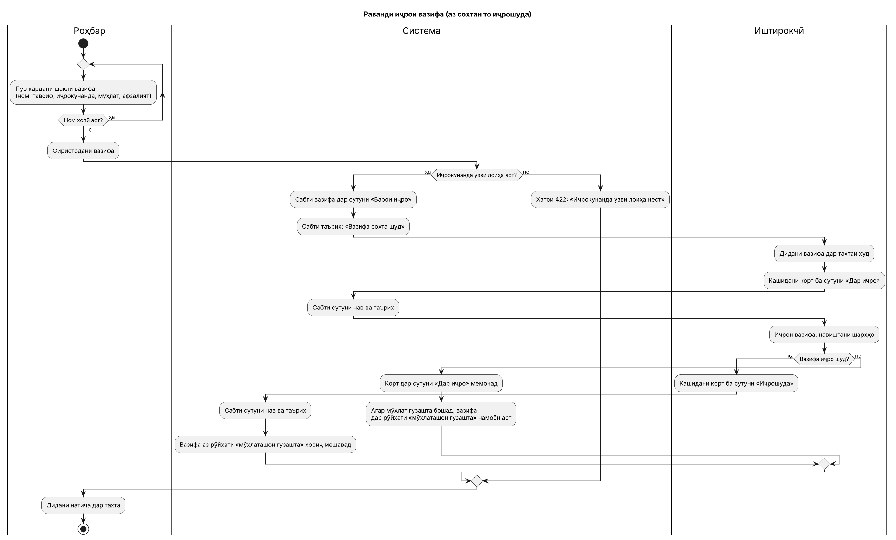
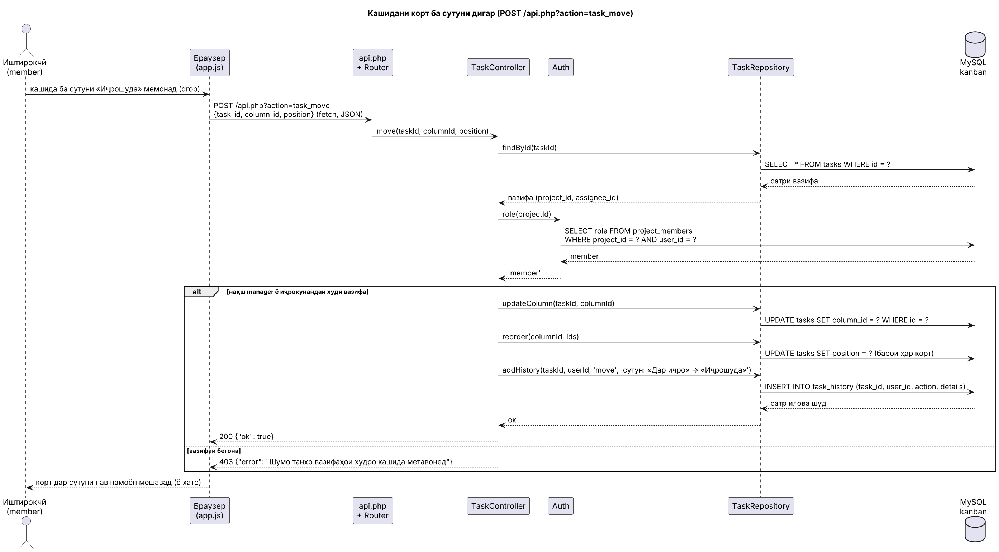
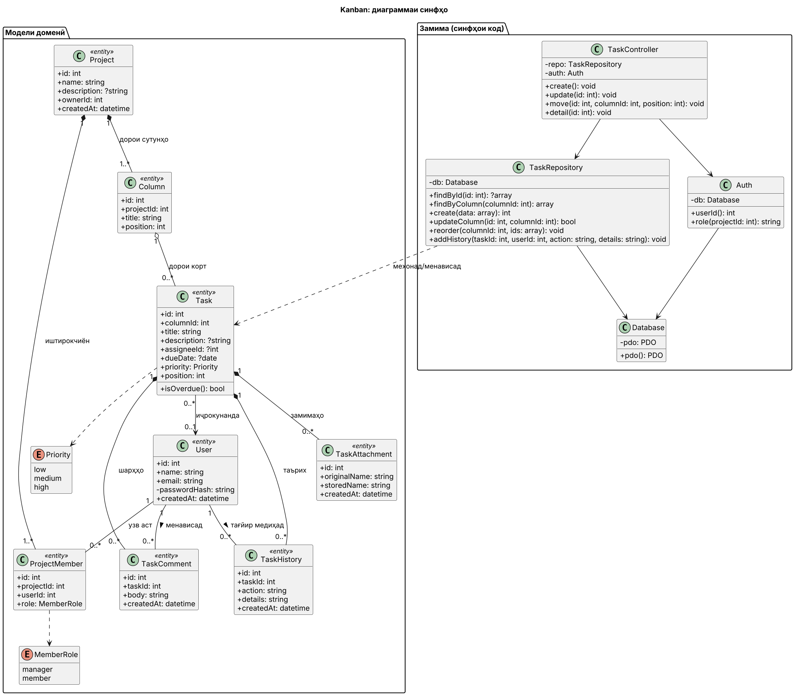
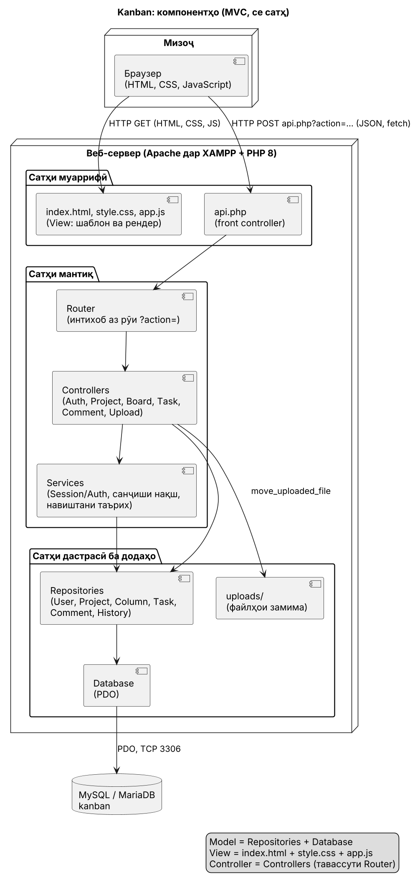
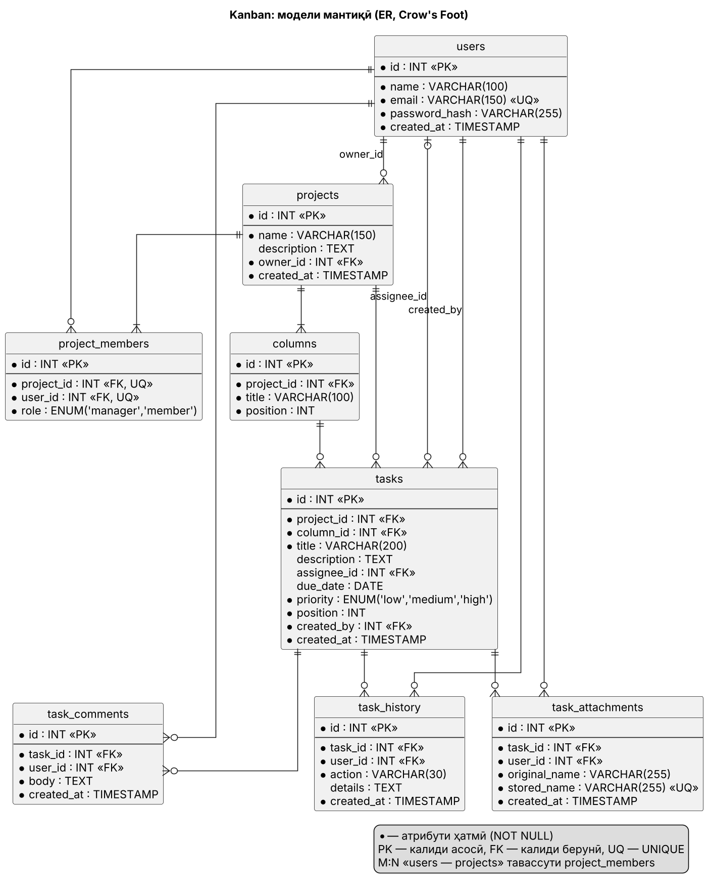
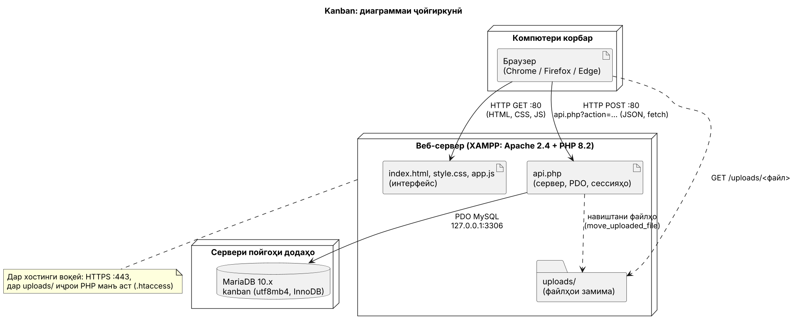

# Супориши техникӣ барои коркарди веблоиҳаи идоракунии вазифаҳои даста «Kanban»

Версияи 1.0 · 13.11.2026 · Барномасоз: Султонов Абдураҳмон Абдунаимович, гр. ______ · Фармоишгар: дастаи коркард ва омӯзгори фан (шартан)

## 1. Маълумоти умумӣ

| Параметр | Қимат |
|---|---|
| Номи пурра | Системаи веб барои идоракунии вазифаҳои даста дар шакли тахтаи канбан |
| Номи кӯтоҳ | Kanban |
| Фармоишгар | Дастаи коркард (ва омӯзгори фан ҳамчун қабулкунанда) |
| Иҷрокунанда | Султонов Абдураҳмон Абдунаимович |
| Асос барои коркард | Супориши таълимӣ, варианти 22: «Коркарди веблоиҳаи идоракунии вазифаҳои даста (канбан)» |
| Мӯҳлати коркард | семестри тирамоҳи 2026 (марҳилаҳо дар бахши 6) |
| Муҳити коркард | XAMPP (Apache, PHP 8.2, MariaDB), VS Code, Git, GitHub |

## 2. Таъинот ва мақсадҳои эҷоди система

**Таъинот.** Система ба даста имкон медиҳад, ки вазифаҳоро дар як тахтаи умумӣ бо сутунҳо («барои иҷро», «дар иҷро», «иҷрошуда») пеш барад: роҳбар вазифа месозад ва таъин мекунад, иштирокчӣ кортро бо муш аз сутун ба сутун мекашад ва шарҳ менависад, ҳар тағйирот дар таърих сабт мешавад.

**Мақсадҳои ченшаванда:**

1. Кашидани корт ба сутуни дигар бе навсозии саҳифа амалӣ мешавад ва ҷавоби сервер ≤ 500 мс аст (НФТ-02).
2. 100 % тағйироти вазифа (сохтан, кашидан, таҳрир, шарҳ, замима) дар таърих бо нишони «кӣ, кай, чӣ» сабт мешавад.
3. Иштирокчӣ 0 вазифаи бегонаро мебинад: ҳар дархост ба вазифаи бегона бо ҷавоби 403 рад карда мешавад.
4. Вазифаи нав (ном, иҷрокунанда, мӯҳлат, афзалият) дар ≤ 30 сония сохта мешавад.
5. Система бо роҳнамои README дар XAMPP дар ≤ 10 дақиқа насб мешавад (импорти `schema.sql` ва кушодани саҳифа).

## 3. Тавсифи объекти автоматикунонӣ

### 3.1. Вазъи ҳозира

Дастаҳои хурд вазифаҳоро дар Excel, чат ё дар коғаз пеш мебаранд. Дар ин ҳолат ҳолати вазифа бо дасти худ навсозӣ мешавад, таърихи тағйирот нест, ҳама ҳамаи вазифаҳоро мебинанд ва мӯҳлатҳои гузашта дида намешаванд.

### 3.2. Нақшҳо ва равандҳо

Нақш ба лоиҳа вобаста аст (ҷадвали `project_members`, майдони `role`):

- **Роҳбари лоиҳа (manager)** — лоиҳа ва сутунҳо месозад, иштирокчиёнро бо email илова мекунад, вазифаҳоро месозад, таҳрир мекунад ва таъин мекунад. Ҳар корбаре, ки лоиҳа месозад, дар он роҳбар мешавад.
- **Иштирокчӣ (member)** — танҳо вазифаҳои худро мебинад, онҳоро мекашад, шарҳ менависад ва файл замима мекунад.

Равандҳои асосӣ: (1) сохтани лоиҳа ва ташкили даста; (2) иҷрои вазифа аз сохтан то «иҷрошуда»; (3) ҳамкорӣ дар вазифа (шарҳ, замима); (4) назорати мӯҳлатҳо ва ҷустуҷӯ (филтр, рӯйхати гузашта).

### 3.3. Луғати истилоҳот

| Истилоҳ | Маъно |
|---|---|
| Тахта | маҷмӯи сутунҳо ва кортҳои як лоиҳа |
| Сутун | марҳилаи иҷрои вазифа (масалан «Дар иҷро») |
| Корт | вазифа бо ном, тавсиф, иҷрокунанда, мӯҳлат ва афзалият |
| Афзалият | паст, миёна ё баланд (`low`, `medium`, `high`) |
| Мӯҳлати гузашта | мӯҳлат аз имрӯз барвақттар аст ва корт дар сутуни охирин нест |
| Таърих | рӯйхати тағйироти вазифа: кӣ, кай ва чиро иваз кард |

### 3.4. Хулосаҳо аз муқоисаи аналогҳо

Муқоиса бо 4 аналог (Trello, Kaiten, YouGile, PLANKA) бо 9 меъёр гузаронида шуд (санаи санҷиш 12.11.2026). Ҷамъи вазндор аз рӯи меъёрҳои санҷидашуда: YouGile 83 %, PLANKA 79 %, Kaiten 68 %, Trello 53 %. Фоизҳо танҳо тақрибан муқоиса мешаванд, чунки маҷмӯи меъёрҳои санҷидашуда фарқ мекунад.

- **Мегирем:** лентаи амалҳо дар корт (Trello), майдони афзалият бо рангҳо (YouGile), хостинги озод дар сервери худӣ ва тарифи ройгон (PLANKA, YouGile).
- **Намекунем:** ҳисоби вақт, CRM, диаграммаи Гант.
- **Фарқият:** иштирокчӣ танҳо вазифаҳои худро мебинад (дар Trello ҳар узви тахта ҳамаро мебинад), таърихи пурраи тағйироти майдонҳо, интерфейс бо забони тоҷикӣ.

## 4. Талабот ба система

### 4.1. Талабот ба система дар маҷмӯъ

**Ғайрифунксионалӣ:**

| ID | Талабот | Чӣ тавр санҷида мешавад |
|---|---|---|
| НФТ-01 | Тахта бо 100 вазифа дар ≤ 1 с кушода мешавад | DevTools → Network |
| НФТ-02 | Ҷавоби сервер ба кашидани корт ≤ 500 мс | DevTools → `task_move` |
| НФТ-03 | Паролҳо танҳо ҳамчун ҳеш (`password_hash`) нигоҳ дошта мешаванд | ҷадвали `users` |
| НФТ-04 | Матни кириллӣ (тоҷикӣ, русӣ) дар UTF-8 бе таҳриф нигоҳ дошта мешавад | ворид кардани «Ҷалилова Зарина», захира, кушодан |
| НФТ-05 | Ҳимоя аз SQL-инъексия (PDO) ва XSS (экранкунӣ); ҳуқуқҳо дар сервер санҷида мешаванд | `` дар ном | матн ҳамчун матн намоиш дода мешавад |
| НФТ-06 | боркунии файли 6 МБ | хато «Файл аз 5 МБ зиёд аст» |
| НФТ-07, НФТ-08 | `phpinfo()`; кушодан дар се браузер | версияҳо мувофиқанд |

**Санҷиши пойгоҳ.** Дархостҳои `database/queries.sql` бояд натиҷаи интизориро диҳанд: дархости 4 — Раҳимов 3, Назарова 2, Каримов 0; дархости 5 — вазифаҳои 8, 2, 4.

## 8. Талабот ба ҳуҷҷатгузорӣ

| Ҳуҷҷат | Мундариҷа |
|---|---|
| `README.md` | тавсифи лоиҳа, насб дар XAMPP, тарзи истифода |
| `docs/` | таҳлил, муқоиса, СТ-и кӯтоҳ, диаграммаҳо (UML, ER, ҷойгиркунӣ), СТ-и пурра |
| `database/` | `schema.sql`, `seed.sql`, `queries.sql` |
| Дастури корбар | саҳифаи 1–2: вуруд, сохтани лоиҳа, тахта, кашидани корт, шарҳ ва замима |
| `15-test-cases.md` | тест-кейсҳо (марҳилаи 5) |
| `16-deploy.md` | дастури нашр дар сервер (марҳилаи 6) |

## 9. Манбаъҳои коркард

- ГОСТ 34.602 — Супориши техникӣ барои эҷоди системаи автоматикунонидашуда.
- Trello, нархҳо: https://trello.com/pricing
- Kaiten: https://en.kaiten.io/tariffs, https://toolfox.ru/services/s/kaiten
- YouGile: https://toolfox.ru/services/s/yougile, https://habr.com/ru/post/537920
- PLANKA: https://docs.planka.cloud/docs/about-planka
- HTML Drag and Drop API: https://developer.mozilla.org/en-US/docs/Web/API/HTML_Drag_and_Drop_API
- PHP: https://www.php.net/manual/ru/ (PDO, `password_hash`); MariaDB: https://mariadb.com/kb/en/
- PlantUML: https://plantuml.com
